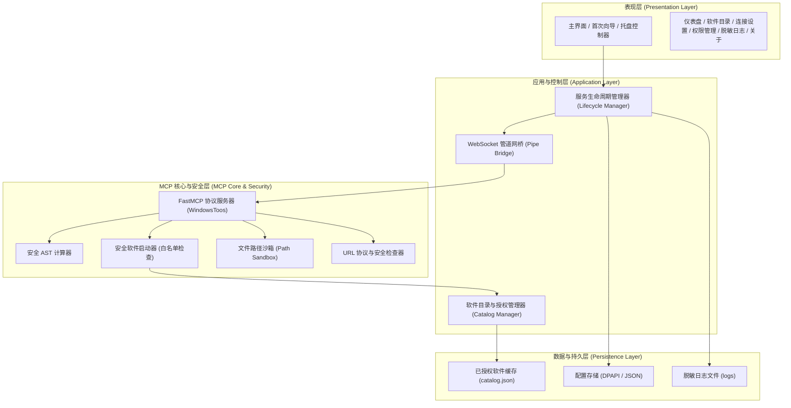

# XiaozhiMcpApp 软件架构设计说明书

## 一、系统架构目标与设计原则

1. **完全解耦与独立性**：
   - 与旧版参考程序物理隔离，新旧程序配置、进程、注册表与安装目录完全独立。
   - 绝不硬编码任何盘符或物理安装路径。
   - 用户安装无需提前配置 Python 环境，所有依赖均自包含打包。

2. **多层安全纵深防御**：
   - **执行隔离**：AST 数学计算白名单、无 `eval`；严格禁止任意 `shell=True` 命令；
   - **授权管控**：软件启动基于内部 ID 和白名单索引，拒绝执行外部任意路径；
   - **沙箱写入**：文件操作仅限用户显式指定的白名单受信任目录，防路径穿越与符号链接攻击；
   - **凭据脱敏**：敏感信息（Endpoint、Token）加密存储于用户配置目录（DPAPI），日志与 UI 彻底脱敏。

3. **标准存储目录规范**：
   - **程序安装目录**：`%LocalAppData%\Programs\XiaozhiMcpApp`
   - **用户配置目录**：`%AppData%\XiaozhiMcpApp`（包含 `config.json` 等）
   - **缓存与日志目录**：`%LocalAppData%\XiaozhiMcpApp`（包含 `catalog.json`、`logs/app.log` 等）

---

## 二、模块架构与分层设计

---

## 三、关键子系统实现方案

### 1. 软件发现子系统 (`catalog/scanner.py`)
- **扫描阶段策略**：
  1. 当前用户与全局 Windows App Paths (`HKCU\Software\Microsoft\Windows\CurrentVersion\App Paths` 及 `HKLM`)；
  2. 64位与32位系统卸载注册表 (`Uninstall` 及 `Wow6432Node\Uninstall`)；
  3. 当前用户与公共开始菜单快捷方式目录 (`%AppData%\...\Start Menu\Programs` 及 `%ProgramData%\...\Start Menu\Programs`)；
  4. 桌面快捷方式 (`Desktop` 及 `Public\Desktop`)；
  5. 系统 `PATH` 目录中的常见可执行文件；
  6. Microsoft Store / UWP 应用（标注为受限启动类型）；
- **去重与合并策略**：
  - 基于规范化可执行文件全路径（去除引号与参数）及主程序名去重；
  - 提取快捷方式名称作为默认中文/别名；
  - 记录来源类型、版本、显示名称、执行参数。
- **验证与授权策略**：
  - 启动前校验文件是否存在 (`os.path.exists`)；
  - 仅标记为 `enabled=True` 的条目允许被 MCP 工具识别和启动；用户随时可在界面取消授权。

### 2. 安全防护引擎 (`core/security.py`)
- **AST 数学计算器**：
  - 基于 Python `ast.parse` 构建抽象语法树；
  - 仅允许节点类型：`ast.Expression`, `ast.BinOp`, `ast.UnaryOp`, `ast.Constant`, `ast.Call`；
  - 仅允许白名单函数：`abs`, `round`, `min`, `max`, `pow`, `sum`, `math.sqrt`, `math.sin`, `math.cos`, `math.tan`, `math.log`, `math.pi`, `math.e` 等；
  - 彻底拒绝任何属性篡改、导入、系统调用或动态代码构造。
- **文件沙箱**：
  - 强制解析目标路径为绝对正规化路径 (`os.path.realpath`)；
  - 检查目标路径是否位于用户明确授权的允许写入目录树之下；
  - 拒绝访问 Windows 敏感目录（`System32`, `Program Files`, 启动项目录等），覆盖已有文件前要求用户策略许可。
- **URL 与命令控制**：
  - 严格限制 URL scheme 为 `http` 或 `https`；
  - 命令工具默认停用；若启用仅允许严格预设匹配（如 `ipconfig`, `systeminfo` 等安全命令），禁止拼接执行。

### 3. WebSocket 管道网桥 (`bridge/pipe.py`)
- 基于 `asyncio` 和 `websockets` 库实现客户端连接；
- 支持与 FastMCP stdio 进程或内部协议线程双向消息泵通信；
- 内置指数退避重连（初始 1s，最大 60s，带随机扰动）；
- 提供明确的 `start()`, `stop()`, `restart()` 生命周期接口，确保退出时所有子进程和通信套接字完全销毁，不遗留孤儿进程。

### 4. 敏感数据与脱敏日志 (`core/config.py`, `core/logger.py`)
- 敏感配置（Token、Endpoint 中的身份凭证）通过 Windows DPAPI (`CryptProtectData`) 加密存储在 `%AppData%\XiaozhiMcpApp\secrets.dat`；
- 日志系统内置脱敏 Filter，使用正则自动屏蔽 Token、Cookie、授权头以及密钥字符串。

---

## 四、进程与部署模型

- **开发与测试**：基于项目独立虚拟环境 `.venv` 运行；
- **打包部署**：使用 PyInstaller `onedir` 模式构建，输出为独立的安装目录；
- **安装脚本**：提供 Inno Setup 编译器配置脚本，实现一键静默或向导式安装，自动设置卸载条目和桌面/开始菜单快捷方式。
